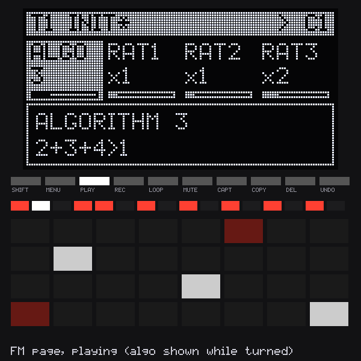
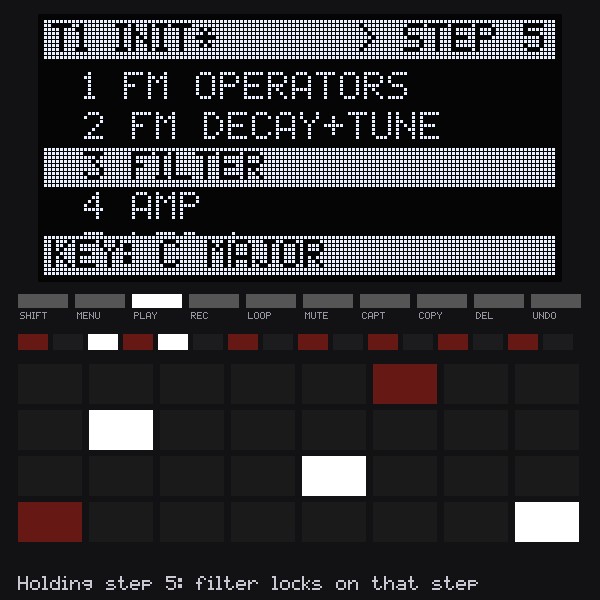
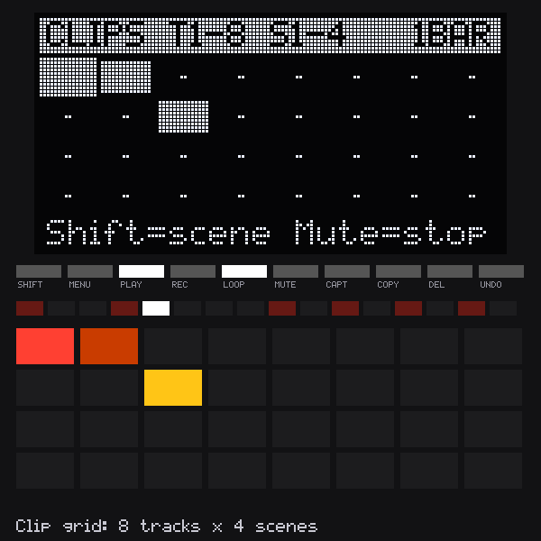
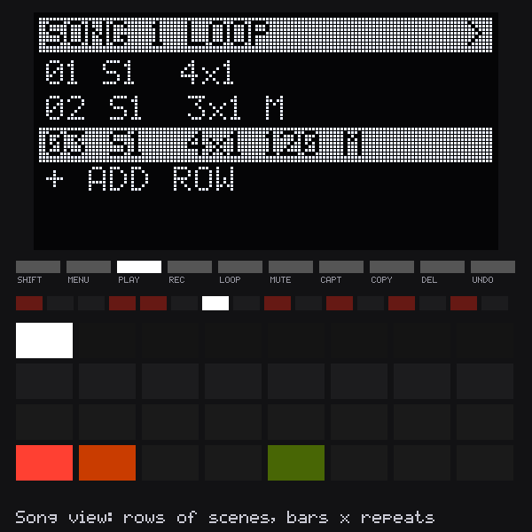
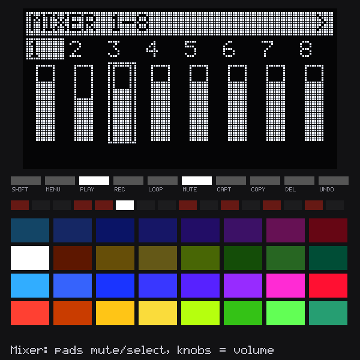
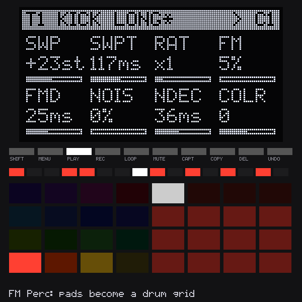
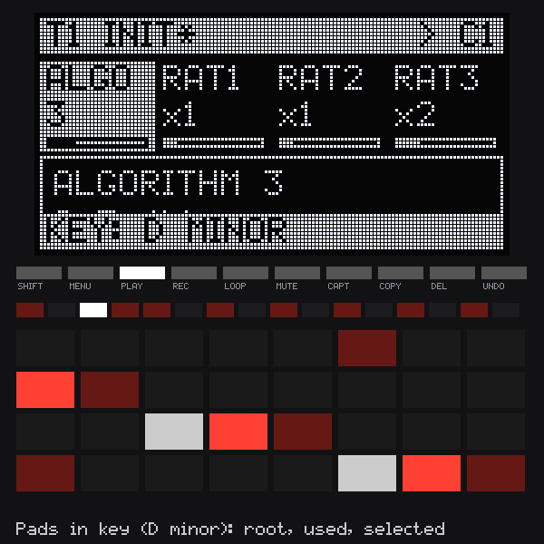
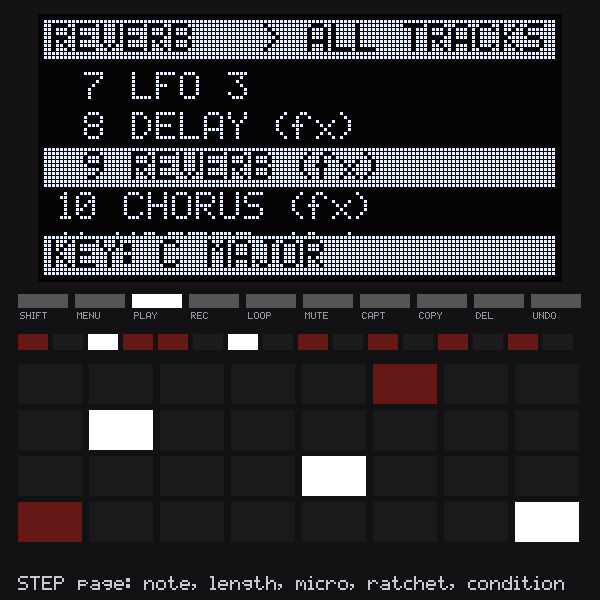
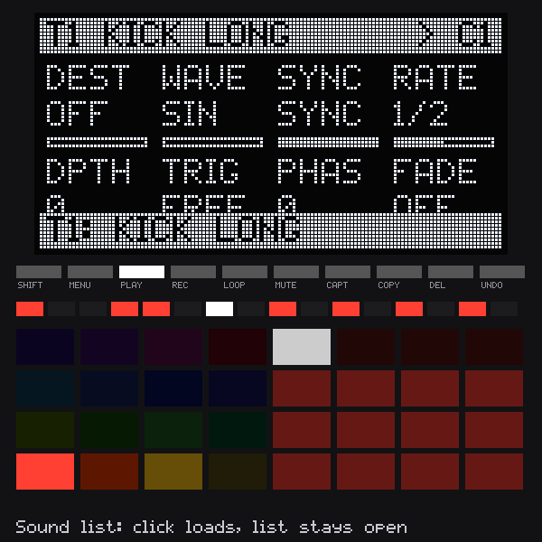

# OpGrid

A 16-track FM groovebox for Ableton Move, built as a [Schwung](https://github.com/charlesvestal/schwung) overtake module: four synth machines, a step sequencer with per-step locks and conditions, clip launching, live recording, song mode, effects, and a starter sound library.

**Status: 0.12.0 beta.** Every feature in the spec is built and covered by automated tests (engine, sequencer, effects, clips, recording, songs, machines, starter sounds, UI, and the UI running against the real engine). **It has not yet been run on a real Move**, so treat this as a beta and please report what you find.

| | | |
|---|---|---|
|  |  |  |
|  |  |  |
|  |  |  |

Screens are rendered by `make screens`: the real UI code driving the real engine, drawn with Schwung's 5x7 font and the Move's LED palette.

## Install

```bash
make test               # all tests; also writes demo WAVs to build/
./scripts/build.sh      # cross-compile for the Move -> build/opgrid-module.tar.gz
MOVE_HOST=ableton@move.local ./scripts/install.sh
```

Requires Schwung on the Move.

- **Open (or quit):** hold **Shift**, touch the **volume knob**, click the **jog wheel**, then choose OpGrid.
- **Leave it running:** Shift + touch volume + **Back**. Open it again the same way to come back.
- On-device help: Schwung's Help viewer, under Modules → OpGrid.

## First minutes

A new project starts with a kit: kick, snare, hat, clap, bass, keys, lead and pad on tracks 1–8.

1. Press **Play**, tap step buttons.
2. **Shift + pad** (bottom row) picks a track. The screen's top line shows the track and its sound.
3. **Click the jog wheel** to browse sounds: turn to hear each one, Left/Right for DRUMS / BASS / KEYS / LEAD / PAD / FX / USER, click to keep, **Back** to put the old one back.
4. **Touch any knob** to see what it does, in words, with its value in Hz, ms, % or dB.
5. **Turn the jog** to change page; a list shows where you are.

## Controls

| Control | Action |
|---|---|
| Step buttons | Toggle steps on the selected track |
| Hold step + knob | Lock that value on the step (sound pages), or edit the step (STEP page) |
| Hold step + pad | Set the step's note; more pads add a chord (up to 4 notes) |
| Delete + step, or hold step + Delete | Clear the step and its locks |
| Delete + pad | Remove that note from the whole clip |
| Shift + Delete | Clear the whole clip (keeps its length and speed) |
| Undo | Undo the last delete or clear (or the last recording take) |
| Shift + step 1–4 | Show steps 1–16 / 17–32 / 33–48 / 49–64 |
| Play | Start / stop |
| Shift + Play | Stop all clips (at the next launch point) |
| Loop | Clip grid on / off |
| Rec | Arm / disarm recording on the selected track |
| Shift + Rec | Click: OFF / COUNT-IN / ON |
| Menu | Project menu (jog to choose, jog click to select) |
| Shift + Loop | Song view / song mode on / off |
| Capture | Capture a live performance as a song |
| Pads | Play the selected track in key (rows 3 scale steps apart, like Move and Push). Bright = a note used in this clip, dim = the key's root, dark grey = other notes in key; holding a step lights its notes white |
| Pad tap | Selects the note new steps get (light grey pad). Steps that play it light bright, other note steps dim |
| Shift + Left / Right | Key root (C, C#, D …) |
| Shift + Up / Down | Scale: major, minor, dorian, mixolydian, harmonic minor, pentatonic, minor pentatonic, blues, chromatic |
| FM Perc tracks | Pads become a drum grid: left 4×4 = tracks 1–16 (tap plays and selects; flashes when it hits), right 4×4 = 16 velocities (sets new steps, or the held step) |
| Shift + pad (bottom 16) | Select track 1–16 |
| Mute + pad (bottom 16) | Mute / unmute a track |
| Mute (tap) | Mixer mode on / off |
| Shift + Mute (hold) | Fill mode |
| Knobs 1–8 | Edit the page's 8 values (Shift = fine) |
| Jog wheel / Left / Right | Change page: SOUND, SOUND 2, FILTER, AMP, LFO 1–3, DELAY, REVERB, CHORUS, MASTER, MIDI, STEP, CLIP |
| Shift + jog | Change the track's machine (on a sound page) |
| Up / Down | Octave |
| Back | Close the current screen (browser, menu, clip grid, mixer, song view) |
| Jog click (sound pages) | Sound browser |
| Touch a knob | Show its full name and value |

External MIDI: channel N plays track N.

### Clip grid (Loop)

8 tracks × 4 scenes on the pads; each track has 8 clip slots. Top pad row = scene 1.

| Control | Action |
|---|---|
| Pad with a clip | Launch it (on the next launch point) and edit it |
| Empty pad | Select it for editing; it becomes a clip once you add steps |
| Shift + pad | Launch that row's scene (empty slots stop their track) |
| Mute + pad | Stop that track |
| Copy (hold) + pad, pad | Copy a clip |
| Delete + pad | Clear a clip |
| Left / Right | Tracks 1–8 / 9–16 |
| Up / Down | Scenes 1–4 / 5–8 |

Launch quantize (CLIP page, QUAN): off, 1 step, 1 beat, 1 bar (default), 2 bars, 4 bars. Steps, locks and clip settings always edit the selected clip, even while another one plays.

### Recording

- Arm with **Rec**, then play pads or turn knobs while the clip plays. Notes land on the nearest step (or keep their offset as micro-timing with RQNT off); held length is recorded. Notes played together become a chord. Knob moves become locks on the current step (the base sound is not changed).
- **RMOD** on the CLIP page: DUB adds to the clip, RPLC clears each step as the playhead passes unless you play on it.
- With click on COUNT-IN or ON, pressing **Play** while armed gives one bar of clicks first. ON also clicks while recording.
- **New clip:** while armed, tap an empty slot in the clip grid. It launches on the next launch point and records; tap it again to set its length to whole bars (1–4). It stops growing by itself at 4 bars.
- **Undo** restores the clip from before the take (one level).

### Song mode (Shift + Loop)

A song is up to 64 rows; 8 songs per project. Each row says which clip every track plays (from a scene, or any mix when captured), which tracks are muted, for how many bars, how many times, and optionally a tempo and a swing for all tracks.

| Control | Action |
|---|---|
| Jog | Choose a row (the last line adds a row) |
| Jog click | On "+ ADD ROW": add a row. While the song plays: jump to that row at the next bar |
| Knobs | SCEN (scene), BARS (1–64), REPS (1–16), TMPO (OFF or BPM), SWNG (OFF or 50–80%), SONG (1–8), LOOP |
| Top pad row | Set the row's scene (1–8) |
| Bottom 16 pads | Mute / unmute a track in the row |
| Copy / Delete | Duplicate / delete the row |
| Play | Play the song from the selected row |

While the song plays, the clip grid shows what is playing but does not launch; Shift + Loop returns to live mode. A song without LOOP stops every track at its end.

**Capture:** press Capture and launch clips, stop tracks and mute live; every bar is recorded, and changes become new rows. Press Capture again to finish. It records into the shown song if empty, else the first empty song.

### Projects

**Menu** opens: BROWSE SOUNDS, SAVE Tn SOUND, SAVE (current name), SAVE AS NEW, NEW PROJECT (starts with the starter kit), and LOAD for each saved project. NEW and LOAD ask for a second click. Projects (including songs) are JSON files in `/data/UserData/schwung/opgrid/projects/`. The session autosaves every 2 minutes when something changed and when the module closes, to `/data/UserData/schwung/opgrid/autosave.json`, and reopens from it next time.

### Sounds

**Jog click** on a sound page (or **Menu → BROWSE SOUNDS**) opens the browser: 32 starter sounds in DRUMS, BASS, KEYS, LEAD, PAD and FX, plus your own under USER. Turning the jog loads each sound on the track as you go, so you hear it (play pads or let the pattern run). **Left/Right** changes category, **click** keeps the highlighted sound, **Back** or **Menu** puts the old sound back exactly. The top line of the screen always shows the track's sound; a `*` means you have changed it since loading. **Menu → SAVE Tn SOUND** saves it to `/data/UserData/schwung/opgrid/sounds/` (it appears under USER). A sound is the machine and every sound, LFO and send setting; the track's MIDI routing is kept.

### Effects

DELAY, REVERB and CHORUS are shared by all 16 tracks; their pages say **ALL TRACKS** at the top. **Knob 8 (SEND)** on each is the selected track's send to that effect. MASTER has the compressor, drive and volume for the whole mix. Effects can't be locked to steps (sends can).

### Mixer mode (tap Mute)

| Control | Action |
|---|---|
| Bottom 16 pads | Mute / unmute track (Shift = solo) |
| Top 16 pads | Select track |
| Knobs 1–8 | Track volume (Left = tracks 1–8, Right = 9–16) |

### Pages

- **STEP** (hold a step): type (note / lock-only), note, velocity, length, micro-timing (±23/48 step), ratchets (1–8), condition, slide. With no step held, NOTE/VEL/LEN set the defaults for new steps.
- **LFO 1–3** (per track, lockable): destination (pitch, any sound value or send), wave (sine, triangle, square, saw, ramp, random), sync or free, rate, depth (±), trigger (free-running or restart per note), phase, fade-in.
- **DELAY** (shared): time (synced, 1/32 to 1 bar, dotted and triplet), repeats, ping-pong, tone (darker ↔ brighter), and this track's SEND.
- **REVERB** (shared): size, decay time, pre-delay, darkness, SEND.
- **CHORUS** (shared): depth, speed, stereo width, SEND.
- **MASTER**: compressor threshold, ratio, makeup gain; drive; master volume.
- **MIDI**: MIDI out channel (OFF or 1–16) and what plays (INT = internal sound, MIDI = USB-A only, BOTH).
- **CLIP**: length (1–64), speed (1/8x–2x), swing (50–80%), tempo, tempo source (MOVE = follow Move's tempo, OWN = this module's), launch quantize, record quantize (RQNT), record mode (RMOD: DUB / RPLC).

### Step conditions

| Condition | Plays when |
|---|---|
| A:B (1:2 … 8:8) | On loop A of every B loops |
| 5% … 95% | That chance |
| FILL / !FIL | Fill mode is held / not held |
| PRE / !PRE | The last conditional step on this track played / did not |
| 1ST / !1ST | First loop since play started / every loop after |

## Machines

Shift + jog on a sound page changes the track's machine. The first two pages are the machine's own; everything else (filter, amp, LFOs, sends) is shared.

| Machine | What it is | Page 1 | Page 2 |
|---|---|---|---|
| FM Poly | 4-operator FM, 8 algorithms, op 4 feedback | ALGO, RAT1–4, LVL2–4 | FDBK, DEC2–4, DTUN, VELM, TUNE, GLID |
| FM Perc | Drums: pitch sweep, 2-op FM body, coloured noise, click | SWP, SWPT, RAT, FM, FMD, NOIS, NDEC, COLR | FDBK, CLIK, –, –, DTUN, VELM, TUNE, GLID |
| Morph | 2 wavetable oscillators morphing across 8 waves, phase distortion, ring mod, sub, drift | WAVA, WAVB, MIX, PD, TUNB, RING, NOIS, DRFT | SUBL, SUBO, –, –, DTUN, VELM, TUNE, GLID |
| Stack | 1–8 detuned copies of a band-limited saw, square, triangle or sine, plus sub and noise | WAVE, VOIC, DTUN, ANIM, SUBL, SUBO, NOIS, MIX | –, –, –, –, DTUN, VELM, TUNE, GLID |

### FM Poly algorithms

| Algo | Routing |
|---|---|
| 1 | 4 > 3 > 2 > 1 |
| 2 | (3 + 4) > 2 > 1 |
| 3 | (2 + 3 + 4) > 1 |
| 4 | 4 > 3 > 1, 2 > 1 |
| 5 | 2 > 1 and 4 > 3, both heard |
| 6 | 4 > 1, 2, 3, all heard |
| 7 | 4 > 3, plus 1 and 2 heard |
| 8 | 1 + 2 + 3 + 4 additive |

When an operator other than 1 is heard (a carrier), its LVL knob sets its volume.

## Performance

12 voices share 16 tracks. Measured on the build machine (x86) per 128-sample block: about 60 µs worst case with 12 FM voices, 3 LFOs each and every effect on; FM Perc ~36 µs, Morph ~45 µs, Stack (8 copies) ~62 µs. The Move's ARM cores are slower, and the budget is roughly 1,000 µs of the ~2,370 µs Schwung reports as free per block. Nothing allocates, locks or touches files on the audio thread.

## Layout

- `src/og_engine.c/.h` — voices, filter, envelopes, LFOs (no allocation or I/O on the audio thread)
- `src/og_machines.c` — FM Perc, Morph and Stack oscillators, wavetables
- `src/og_seq.c` — sequencer, runs every 16 samples inside the audio callback
- `src/og_fx.c` — delay, reverb, chorus, master bus
- `src/og_rec.c` — recording, count-in/click, undo, reset, clip serialization
- `src/og_song.c` — song rows, bar-accurate song playback, performance capture
- `src/og_plugin.c` — Schwung plugin API v2 glue and param protocol
- `src/ui.js` — screen, pads, knobs, LEDs, projects and sounds
- `ROADMAP.md` — what is planned next
- `module/` — module.json, help.json, sounds.json (generated by `tools/make_sounds.mjs`)
- `tools/` — engine bridge and screenshot renderer, starter sound generator
- `test/` — C engine, sequencer, effects, clip, recording and song tests (incl. a 10-minute drift test and a 20 s max-feedback stability test), machine and starter-sound tests, Node UI tests with a fake host, fake DSP and in-memory filesystem, and a help-text width check
